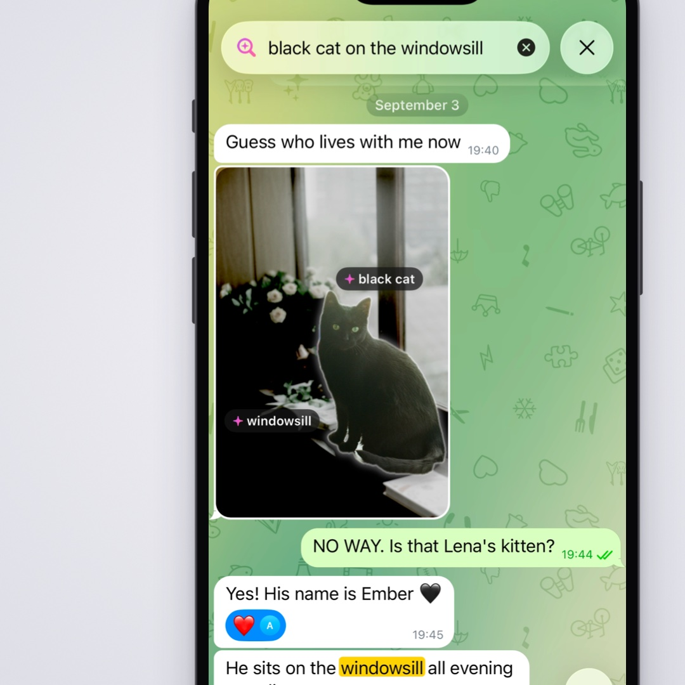
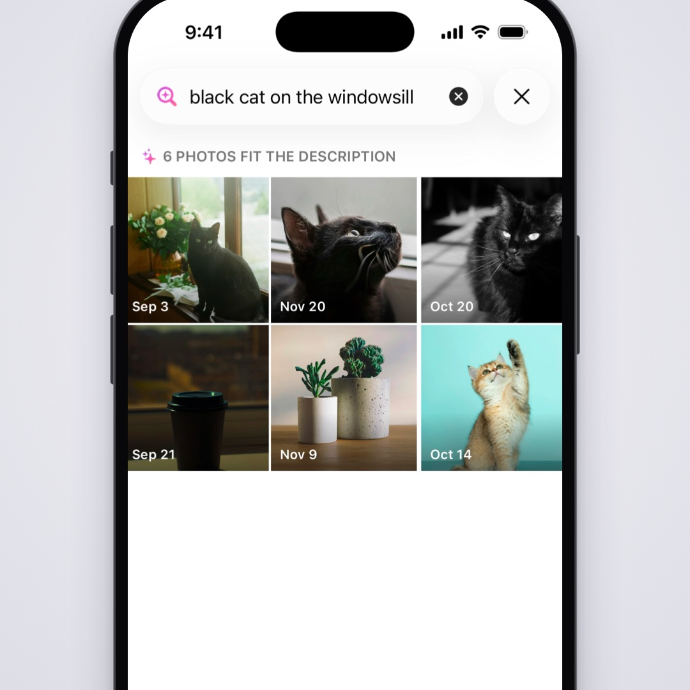

# Find in Photos — a Telegram iOS concept

Search a Telegram chat by what is in a photo.

You remember the picture — a black cat on a windowsill — but not who sent it or when. Search the chat as usual, then tap **Find in Photos**: the same words go to an on-device model that looks through the chat's photos, the chat jumps straight to the best match, and what was recognised is lifted out of the shot.

  
  

▶️ **[Watch the demo](media/find-in-photos.mp4)**

## What it does

- **Regular search stays as it is.** Glass field in place of the header, matches highlighted in the bubbles, "1 of N", arrows, "Show as List" — the in-chat search of Telegram for iOS.
- **Find in Photos, on request.** Photos are searched only when you tap the button, with the words already in the field. While the model looks, the button and the field shimmer.
- **Subject lift, inside the photo.** The recognised subject is cut out and brought forward a touch over a soft shadow, a white light runs around its outline, the rest of the photo dims and loses its colour. The matched words — "black cat", "windowsill" — sit next to what they matched. On a phone the subject shifts slightly with the tilt.
- **Every match.** Arrows step through the photos, "Show as List" shows all of them as a media grid, tapping a photo opens the viewer with the lift carried over.

## Run it

Open `TGEdit.xcodeproj`, pick the **TGEdit** scheme and run on an iOS 26 simulator or device (set your own signing team for a device). Tap the contact's name in the header to start searching, type something like `black cat on the windowsill`, then tap **Find in Photos**.

Launch argument `-recallPromo` plays the scripted run from the video.

## How it's built

- UIKit, iOS 26 Liquid Glass, no third-party code.
- `TGEdit/ChatSearch.swift` — the search: top field, bottom controls, Find in Photos, results list and photo grid.
- `TGEdit/SubjectLift.swift` — the subject lift and the media viewer.
- `TGEdit/PhotoRecall.swift` — matching of text and descriptions, AI glow and sparkle visuals.
- `TGEdit/Photos.swift` — the demo photos and what is "seen" on each.

## Prototype notes

- Recognition is simulated: each demo photo carries tags and labelled regions. Subject cut-outs were made with Apple Vision's foreground instance mask and are shipped as images (`TGEdit/RealPhotos/mask_*`, `edge_*`, `glow_*`, `shadow_*`).
- The chat is a local prototype of Telegram's chat screen; nothing is sent anywhere.
- Photos are from Unsplash — see `TGEdit/RealPhotos/CREDITS.md`.
